<div align="center">



<br/>

[](https://www.linkedin.com/in/subodh-kumar-3a34402aa/)
[](https://subodhportfoliosde.netlify.app/)
[](mailto:subodhkumar31122002@gmail.com)


</div>

---

## 👨‍💻 About me

```java
public class SubodhKumar implements BackendDeveloper {

    String role       = "Java Backend Developer";
    String education  = "B.Tech CSE, GEC Kaimur (CGPA 8.41)";
    String experience = "Data Analytics, AI & GIS Intern, Govt. of Bihar";
    String focus      = "Thread-safe, secure, well-tested REST APIs";
    int    dsaSolved  = 200; // LeetCode + GeeksforGeeks

    @Override
    public Mission mission() {
        return Mission.buildScalableBackendSystems();
    }
}
```

## 🛠 Tech Stack


## 🚀 Featured Projects

### 💳 [Fintech Digital Wallet Ledger](https://github.com/Subodh-Kumar-tech/REPO-NAME)
Thread-safe wallet API for secure fund transfers.
- Atomic balance updates with `@Transactional` and row-level locking, no race conditions under concurrent load
- `BigDecimal` arithmetic so there is no precision loss
- Stateless JWT authentication with user-level authorization
- Unit and integration tests with JUnit 5 and Mockito

`Java 17` `Spring Boot` `JPA` `PostgreSQL` `JWT` `JUnit 5`

### 🧑‍💼 [ATS Job Board & Recruitment Backend](https://github.com/Subodh-Kumar-tech/REPO-NAME)
Multi-role recruitment platform backend.
- RBAC for Job Seekers, Recruiters and Admins with custom token filters
- Dynamic candidate search using Spring Data JPA Specifications
- Async status-update notifications via Spring Application Events
- Centralized error handling with `@RestControllerAdvice`

`Java 17` `Spring Boot` `JPA` `MySQL` `JWT` `Mockito`

## 🎯 What I'm focused on

| | |
|---|---|
| 🔧 Building | Production-style Spring Boot backends |
| 📚 Learning | Microservices, Docker Compose, CI/CD with GitHub Actions |
| 🧩 Practicing | DSA problems on LeetCode & GeeksforGeeks |

## 📊 GitHub Stats

<div align="center">


</div>

---

<div align="center">

*Open to Java Developer / Backend Engineer opportunities. Let's connect!* 🤝

</div>
